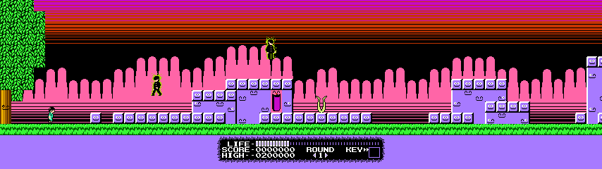
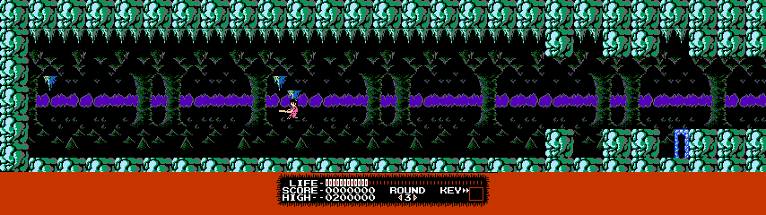
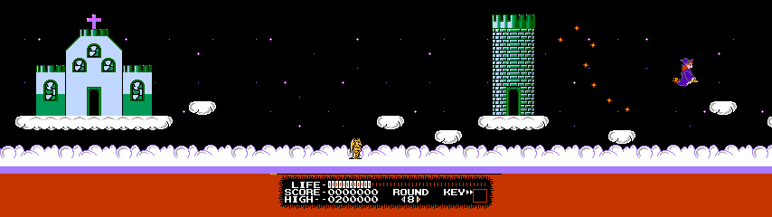

# Monster Party Recompiled

Play **Monster Party** on Windows and Linux with adaptive widescreen, controller
support, save states, rewind, and a modern launcher. Join Mark and Bert for the original eight-round
adventure.

## Download and play

1. Download the Windows ZIP or Linux AppImage from the
   [latest release](https://github.com/mstan/MonsterPartyNESRecomp/releases/latest).
2. **Windows:** extract the complete ZIP and open `MonsterPartyRecomp.exe`.
   **Linux:** make the AppImage executable and open it.
3. Select your original **Monster Party (USA)** ROM in the launcher.
4. Set up your keyboard or controller, then choose **PLAY**.

No game ROM is included. The launcher checks that your ROM is supported.
Downloads are for 64-bit Windows and Linux. The Linux build targets Ubuntu 22.04
or newer and comparable distributions, with an OpenGL 3.3 capable graphics driver.

## A wider view

Enable **Adaptive Widescreen** under **Mods > Display**. Its only setting is
**Aspect**: choose **Fit** to follow your window, or select 16:9, 21:9, or 32:9.
Enemies appear across the wider view, and the stage camera stops at level edges.
The life bar stays centered below the action, and boss rooms keep their centered
presentation.







*Actual gameplay captures from this release.*

## Controls and progress

Keyboard and controller bindings can be changed in the launcher.

| Action | Default key |
| --- | --- |
| Move | Arrow keys |
| A / B | Z / X |
| Start / Select | Enter / Backslash |
| Menu | Escape |
| Save-state browser | F7 |
| Rewind | F8 |

**F7** opens twelve save slots with thumbnail previews. Choose a slot, press
**S** to save or **Enter** to load. On a controller, use **Back + L3** to open
the browser, **X** to save, **A** to load, and **B** to close.

**F8** opens rewind. Use **Left / Right** to choose an earlier moment, then
**Enter / A** to resume there. **Escape / B** cancels. The controller shortcut
is **Back + R3**. Rewind starts enabled; its history settings are in the launcher.

Keep the game's passwords for progress you want to carry into an update.
Save states are specific to a build and may not carry between releases.
Windows keeps settings beside the program. Linux keeps them in your user data
folder (`~/.local/share/MonsterParty` by default).

## Help and feedback

[Report a problem](https://github.com/mstan/MonsterPartyNESRecomp/issues) with
your version, operating system, aspect setting, and the steps that caused it.
A screenshot is helpful.

If Linux reports that FUSE is unavailable, run the AppImage with:

```sh
chmod +x MonsterParty-0.1.1-linux-x86_64.AppImage
./MonsterParty-0.1.1-linux-x86_64.AppImage --appimage-extract-and-run
```

For source builds, see the [build guide](docs/BUILDING.md).
Development coverage and known limitations are in the
[validation notes](docs/development/VALIDATION.md).

## Credits and license

Monster Party and its original artwork belong to their respective owners.
This is an unofficial fan project built with
[NESRecomp](https://github.com/mstan/nesrecomp) and
[recomp-ui](https://github.com/mstan/recomp-ui).
Project code uses the [PolyForm Noncommercial license](LICENSE.md).
Third-party notices accompany the downloads. Box artwork is credited in
[assets/SOURCE.txt](assets/SOURCE.txt).

---

<p align="center">
  <sub><b>R.A.I.D. — Retro AI Development</b> · a Discord for AI-assisted retro reverse-engineering, decomp &amp; recomp</sub>
</p>

<p align="center">
  <a href="https://discord.gg/Ad9BwSzctP"></a>
</p>
